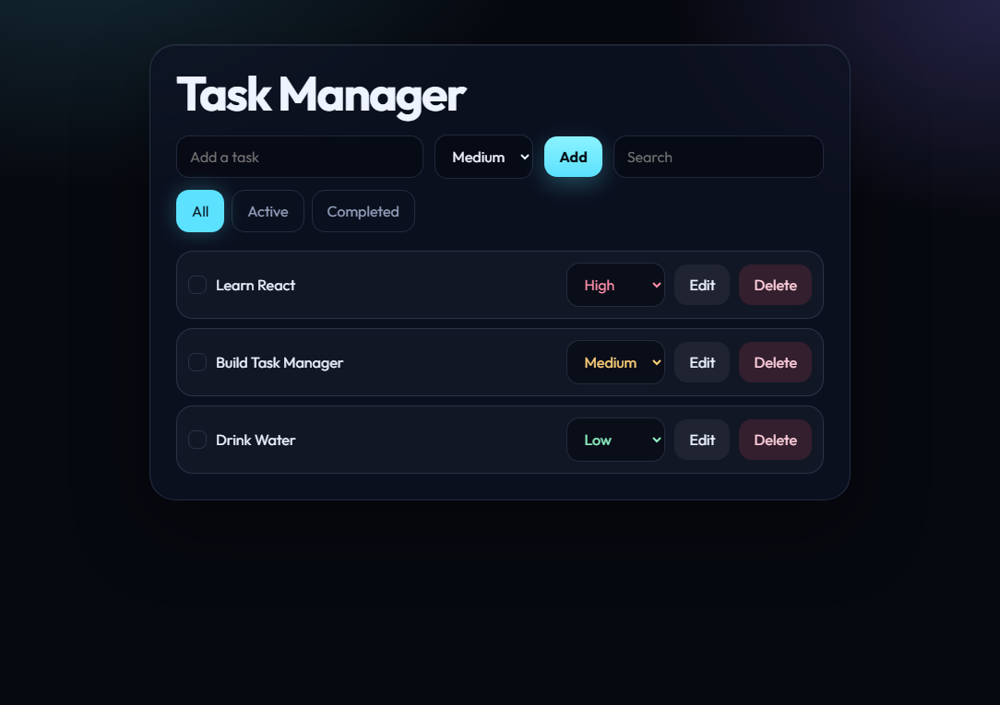
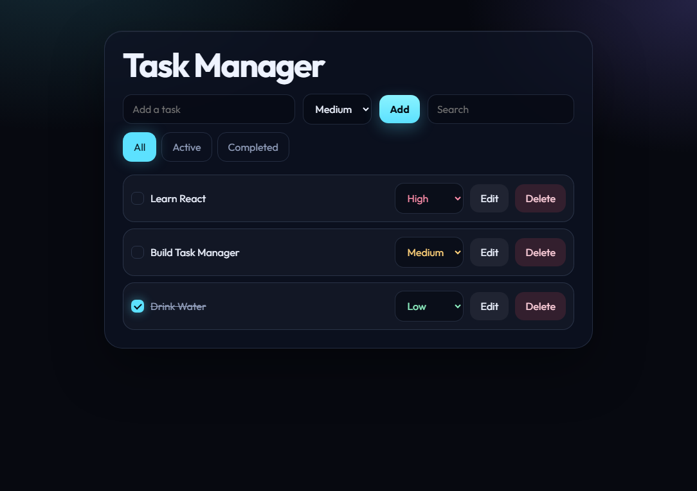
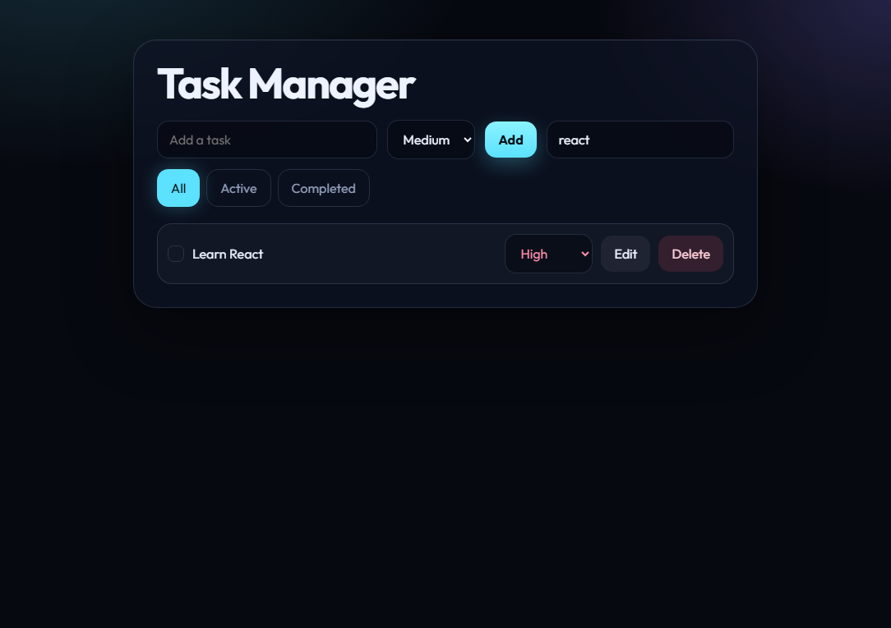

# Task Manager

A React and TypeScript task app. The list stays in the browser after a refresh, saved in `localStorage`.

## Screenshots

The main board, with a different priority on each task:



A completed task stays in the list, with the title crossed out:



Search works together with the current filter. Here, `react` leaves only Learn React:



## Features

- Add a task with a title and a priority (Low, Medium, High)
- Delete a task
- Mark a task completed or pending
- Edit the title
- Filter by All, Active, and Completed
- Search titles, ignoring letter case
- Save the list in `localStorage`

## Run it

```bash
npm install
npm run dev
```

The app opens at `http://localhost:5173`.

For a production build:

```bash
npm run build
npm run preview
```

## Stack

- React 19
- TypeScript
- Vite

The screen lives in `src/App.tsx`. Page styles are in `src/index.css`. The card, buttons, and rows are in `src/App.css`.
